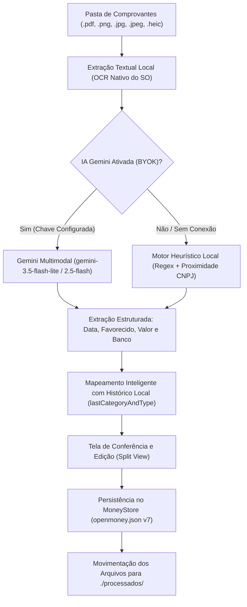

# ADR 007: Arquitetura de Importação de Comprovantes via OCR Nativo e IA Multimodal (BYOK)

## Status
**Aceito e Implementado** (02/11/2026)

---

## Contexto
O processo tradicional de lançamento de despesas requer digitação manual de favorecido, valor, data, conta e categoria para cada cupom fiscal (NFC-e), comprovante de máquina de cartão (POS) ou recibo em PDF/imagem.

Buscava-se uma solução automatizada para escanear uma pasta inteira de comprovantes com os seguintes requisitos:
1. **Privacidade e Custo:** Sem necessidade de servidores dedicados pagos nem exposição de credenciais globais compartilhadas.
2. **Alta Fidelidade Contábil:** Identificação precisa do estabelecimento comercial real (sem confundir com a máquina de cartão ou cabeçalhos fiscais) e do valor líquido pago (sem confundir com tributos ou parcelas).
3. **Multiplataforma:** Suporte a versões Desktop (macOS e Windows) no **Swift** e no **Flutter**, com paridade estrita.
4. **Organização Física:** Movimentação automática e atômica dos documentos conferidos para uma subpasta `processados/`.

---

## Decisão de Arquitetura

Adotou-se uma arquitetura em camadas híbrida composta por:

### 1. OCR Nativo do Sistema Operacional (100% Local e Gratuito)
* **macOS (Swift & Flutter macOS):** 
  * PDFs vetoriais: `PDFKit` (extração de texto instantânea sem renderização de bitmap).
  * Imagens e PDFs escaneados: `Apple Vision Framework` (`VNRecognizeTextRequest`) com reconhecimento em português brasileiro (`pt-BR`).
* **Windows (Flutter Windows):**
  * API nativa WinRT **`Windows.Media.Ocr.OcrEngine`** via decodificação de `SoftwareBitmap` e reconhecimento no idioma `pt-BR`.

### 2. Reconhecimento Multimodal via IA (Google Gemini - Modelo BYOK)
* **Conceito BYOK (*Bring Your Own Key*):** O usuário pode ativar a IA e inserir sua própria chave de API gratuita obtida diretamente no Google AI Studio (com cota individual de até 1.500 requisições diárias gratuitas).
* **Modelos Suportados:**
  * Primário: `gemini-3.5-flash-lite` (baixa latência, visão multimodal e alta precisão contábil).
  * Fallbacks em cascata: `gemini-2.5-flash` e `gemini-flash-latest`.
* **Prompt com Regras Críticas:**
  * Descarte de marcas de maquinário POS (*laranjinha*, *cielo*, *stone*, *getnet*, *safrapay*, *bin*, *rede*).
  * Descarte de identificadores fiscais (*CNPJ do Emitente*, *Consumidor*, *Documento Auxiliar*, *NFC-e*).
  * Descarte de endereços e cidades na identificação do favorecido.
  * Captura do valor final da transação, ignorando valores aproximados da Lei de Tributos (12.741) e parcelas individuais.

### 3. Aprendizado e Categorização Heurística Local
* O sistema cruza o favorecido identificado com o histórico existente no banco do usuário (`lastCategoryAndType` e `payeeSuggestions`).
* Utiliza pontuação por similaridade de palavras (*token matching* de palavras com 4+ letras).
* Atribui automaticamente a conta bancária identificada e a categoria/subcategoria habitual.

### 4. Ciclo de Vida dos Arquivos (`processados/`)
* Ao concluir a importação, os comprovantes válidos selecionados são movidos com garantia atômica para uma subpasta `processados/` dentro do mesmo diretório de origem, prevenindo reprocessamentos duplicados.

---

## Consequências e Resultados

* **Precisão Elevada:** Eliminação de falsos positivos em cupons com tributos e comprovantes de maquininhas de cartão.
* **Privacidade e Isolamento:** Cada usuário opera com sua chave isolada no seu dispositivo (`UserDefaults` no Swift macOS, `config.json` no Flutter Desktop), sem custo para os mantenedores do projeto.
* **Resiliência:** Operação offline garantida via OCR nativo do SO quando o usuário opta por não utilizar IA ou não tem acesso à internet.
