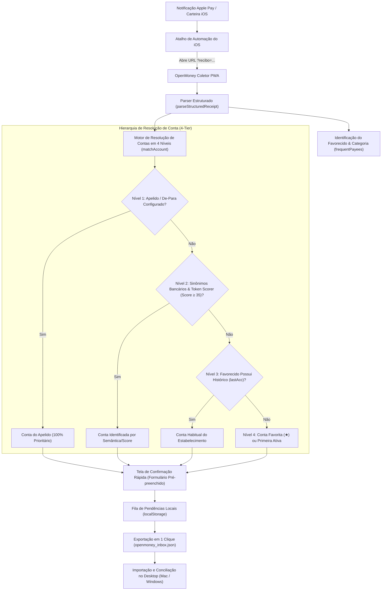

# ADR 008: Arquitetura do Coletor Mobile PWA, Automação via Atalhos do iOS e Resolução de Contas em 4 Níveis

## Status
**Aceito e Implementado** (03/11/2026)

---

## Contexto

O registro de despesas e compras no momento em que ocorrem (na rua, no trânsito ou no caixa do estabelecimento) é fundamental para a saúde financeira pessoal. No entanto, o usuário muitas vezes não está com seu computador aberto e precisa de um fluxo que leve poucos segundos no iPhone ou smartphone.

Duas situações frequentes exigiam solução:
1. **Captura via Atalhos do iOS (Apple Shortcuts / Apple Wallet)**: Ao realizar uma compra por aproximação com Apple Pay ou receber uma notificação de banco no iOS, uma automação de atalhos captura os dados e abre o Coletor via URL com parâmetros estruturados (`?recibo=Data:...;Conta:...;Favorecido:...;Valor:...;`).
2. **Divergência de Nomenclatura das Contas**: O nome do cartão exibido nas notificações da Carteira da Apple raramente coincide de forma exata com o nome atribuído pelo usuário à sua conta no OpenMoney. Exemplos reais:
   - Notificação da Carteira: `Nubank Mastercard Ultravioleta` $\leftrightarrow$ Base do Usuário: `Nubank UV Black`
   - Notificação da Carteira: `Nubank Mastercard Platinum` $\leftrightarrow$ Base do Usuário: `Nubank Cartão`
   - Notificação da Carteira: `AMERICAN EXPRESS GOLD CREDIT` $\leftrightarrow$ Base do Usuário: `Amex`
   - Notificação da Carteira: `Cartão C6 Carbon Mastercad` $\leftrightarrow$ Base do Usuário: `C6 Crédito`

Além disso, era necessário:
- Permitir operação 100% offline via Progressive Web App (PWA) instalável na tela de início.
- Suportar reconhecimento multimodal via Google Gemini Flash (modelo BYOK) diretamente pela câmera do celular.
- Manter o repositório consolidado e acessível exclusivamente em `https://fsf77.github.io/openmoney-new/coletor/`.

---

## Decisão de Arquitetura

Adotou-se uma arquitetura em camadas para o PWA Coletor, integrando leitura de parâmetros de URL, motor heurístico de resolução de contas em 4 níveis (4-Tier) e integração com Atalhos do iOS:



---

### 1. Parâmetros de URL Estruturados (`?recibo=`)

O Coletor aceita chamadas externas de atalhos e automações via `window.location.search`.
O parâmetro `recibo` (ou `ocr_text`) aceita múltiplos delimitadores (ponto-e-vírgula `;`, nova linha `\n` ou `&`) e variações de maiúsculas/minúsculas:

```text
https://fsf77.github.io/openmoney-new/coletor/?recibo=Data:03/11/2026;Conta:Nubank Mastercard Ultravioleta;Favorecido:Drogasil;Valor:30,99;
```

Chaves suportadas:
- **Data:** `Data` ou `Date` (formatos `DD/MM/AAAA` ou `AAAA-MM-DD`).
- **Conta:** `Conta`, `Cartão`, `Cartao`, `Account` ou `Card`.
- **Favorecido:** `Favorecido`, `Estabelecimento`, `Loja`, `Payee` ou `Local`.
- **Valor:** `Valor`, `Total` ou `Amount` (converte automaticamente decimais com vírgula ou ponto em centavos inteiros).
- **Categoria (opcional):** `Categoria` ou `Cat`.
- **Memo (opcional):** `Memo`, `Obs` ou `Nota`.

---

### 2. Hierarquia de Resolução de Conta em 4 Níveis

Para garantir que a conta correta seja selecionada sem esforço manual do usuário:

#### Nível 1 — Tabela De $\rightarrow$ Para (Apelidos Configurados)
No modal de configurações (⚙️), o usuário pode cadastrar apelidos explícitos vinculando qualquer string que venha nas notificações à respectiva conta cadastrada.
- Persistência em `localStorage['om_coletor_account_aliases']`.
- Comparação exata e por substring insensível a acentuação e caixa (`normalizeStr`).

#### Nível 2 — Motor de Sinônimos Bancários & Token Scorer
Quando não há apelido manual cadastrado, o algoritmo avalia todas as contas ativas do usuário:
1. **Filtragem de Ruídos (Noise Words)**: Termos genéricos são desconsiderados na pontuação de marca (`mastercard`, `visa`, `elo`, `cartao`, `credit`, `credito`, `debito`, `banco`).
2. **Expansão de Grupos de Sinônimos**:
   - `uv` $\leftrightarrow$ `ultravioleta`
   - `amex` $\leftrightarrow$ `american express`
   - `c6` $\leftrightarrow$ `carbon`
   - `bb` $\leftrightarrow$ `banco do brasil` $\leftrightarrow$ `ourocard`
   - `itau` $\leftrightarrow$ `itaucard` $\leftrightarrow$ `personnalite`
   - `inter` $\leftrightarrow$ `banco inter`
   - `santander` $\leftrightarrow$ `van gogh` $\leftrightarrow$ `sx`
3. **Detecção e Penalização de Conflitos de Categoria de Cartão**:
   - Se a notificação especifica `ultravioleta` e a conta candidata é `platinum` ou genérica, aplica-se penalidade.
   - Garante que `Nubank Mastercard Ultravioleta` selecione `Nubank UV Black`, enquanto `Nubank Mastercard Platinum` selecione `Nubank Cartão`.
4. **Bônus de Tipo de Conta**: Contas do tipo `Cartão de crédito` recebem pontuação adicional quando a notificação contém termos de pagamento com cartão.
5. Limiar de confiança fixado em $Score \ge 35$.

#### Nível 3 — Memória Habitual de Conta do Favorecido (`lastAcc`)
Na rotina de importação da base `openmoney.json`, o Coletor extrai os estabelecimentos frequentes (`frequentPayees`) e salva não apenas a última categoria utilizada, mas também a **última conta utilizada (`lastAcc`)**:
```javascript
payeeMap.set(norm, {
  payee: clean,
  cat: t.cat || '',
  lastAcc: t.acc || '',
  isExpense: t.amt < 0,
  count: 1,
  lastDate: t.date
});
```
Se a notificação não trouxer o campo `Conta:` ou se o nome do cartão não pontuar no Nível 2, o Coletor consulta se o estabelecimento já foi frequentado e sugere automaticamente a mesma conta usada na última compra.

#### Nível 4 — Fallback Seguro
Caso o estabelecimento seja inédito e o cartão não seja reconhecido, o sistema seleciona a conta marcada como **Favorita (★)** ou a primeira conta ativa.

---

### 3. Automação via Atalhos do iOS (Apple Shortcuts)

Para facilitar a adesão do usuário, o Coletor disponibiliza um botão direto na tela de configurações ⚙️ para instalação do atalho oficial hospedado no iCloud:
- **Link Oficial do Atalho:** `https://www.icloud.com/shortcuts/47a65df3d9c94513bba1af90b1a3ed4e`
- O atalho lê os parâmetros da notificação bancária no iPhone e dispara o Coletor via Safari/PWA em menos de 1 segundo.

---

### 4. Reconhecimento Multimodal via IA Google Gemini (BYOK)

Para comprovantes impressos ou fotos de recibos capturadas diretamente pela câmera do smartphone:
- Integração BYOK (*Bring Your Own Key*) com chave gratuita do Google AI Studio.
- Processamento com visão computacional do modelo `gemini-3.5-flash-lite` / `gemini-2.5-flash`.
- Descarte de marcas de maquinário POS (Cielo, Rede, Stone) e cabeçalhos fiscais (NFC-e, CNPJ).

---

### 5. Resumo das Atualizações no Ecossistema

1. **Repositório e Publicação:**
   - O Coletor reside exclusivamente em `/Users/fabiano/Developer/OpenMoneyFlutter/coletor`.
   - Publicação oficial via GitHub Pages em `https://fsf77.github.io/openmoney-new/coletor/`.
   - Remoção definitiva de instâncias duplicadas legadas em `OpenMoneySwift/coletor` e `openmoney-releases`.
2. **Cache e PWA:**
   - Service Worker com cache offline versionado (`openmoney-coletor-v1.3.1`).
   - Atualização automática em segundo plano para dispositivos móveis.
