# Diagrama Completo da Aplicação OpenMoney Flutter — Arquitetura, Modelos, Fluxos e Regras de Negócio

> **Stack Documentada:** **OpenMoneyFlutter** ([`/Users/fabiano/Developer/OpenMoneyFlutter`](file:///Users/fabiano/Developer/OpenMoneyFlutter)) — Flutter/Dart (macOS, Windows, Web PWA e Mobile)  
> **Schema da Base:** `v: 7` (Canônico Oficial — OpenMoney Flutter)  
> **Escopo:** Visão integral de bootstrap, UI responsiva, gerenciamento de estado (`MoneyStore`), motor de sincronização em tempo real (`SyncEngine` — Sync v2), blindagem Anti-Wipe, modelo de dados e todas as regras de negócio contábeis, cambiais e de importação.

---

## Sumário

1. [Arquitetura Macro em Camadas (Bootstrap, UI, Store, Serviços e Persistência)](#1-arquitetura-macro-em-camadas)
2. [Diagrama de Classes e Modelo de Dados (Schema v: 7)](#2-diagrama-de-classes-e-modelo-de-dados-schema-v-7)
3. [Ciclo de Boot, Modos de Operação e Blindagem Anti-Wipe em 3 Camadas](#3-ciclo-de-boot-modos-de-operação-e-blindagem-anti-wipe-em-3-camadas)
4. [Motor de Sincronização Granular em Tempo Real (SyncEngine — Sync v2)](#4-motor-de-sincronização-granular-em-tempo-real-syncengine--sync-v2)
5. [Regras de Negócio: Cartão de Crédito, Competência `ik` e Quitação (`syncCards`)](#5-regras-de-negócio-cartão-de-crédito-competência-ik-e-quitação-synccards)
6. [Regras de Negócio: Recorrências (`syncRecs`), Parcelamentos e Escopo (`ScopeChoice`)](#6-regras-de-negócio-recorrências-syncrecs-parcelamentos-e-escopo-scopechoice)
7. [Regras de Negócio: Previsões Orçamentárias (`adjustPredictions`) e Limite de Gastos (`checkBudgetExceeded`)](#7-regras-de-negócio-previsões-orçamentárias-e-limite-de-gastos)
8. [Regras de Negócio: Multi-Moeda, Câmbio Histórico e Motores Analíticos (`CashFlowEngine` vs. `ReportsView`)](#8-regras-de-negócio-multi-moeda-câmbio-histórico-e-motores-analíticos)
9. [Pipeline de Importação (CSV, QIF, OCR, IA Gemini, Apple Wallet, Coletor e Shortcuts)](#9-pipeline-de-importação-ocr-ia-e-resolução-de-contas-em-4-níveis)
10. [Inventário Completo de Módulos, Views, Modais, Serviços e Atalhos](#10-inventário-completo-de-módulos-views-modais-serviços-e-atalhos)

---

## 1. Arquitetura Macro em Camadas

A aplicação inicia em [`main.dart`](file:///Users/fabiano/Developer/OpenMoneyFlutter/lib/main.dart), captura eventuais parâmetros de atalhos na URL (`ShortcutUrlService`), resolve versão/build (`OpenMoneyVersion.init()`) e executa `MoneyStore.boot()` **sincronamente antes do primeiro frame**, garantindo que a UI nunca renderize uma tela vazia indevidamente.

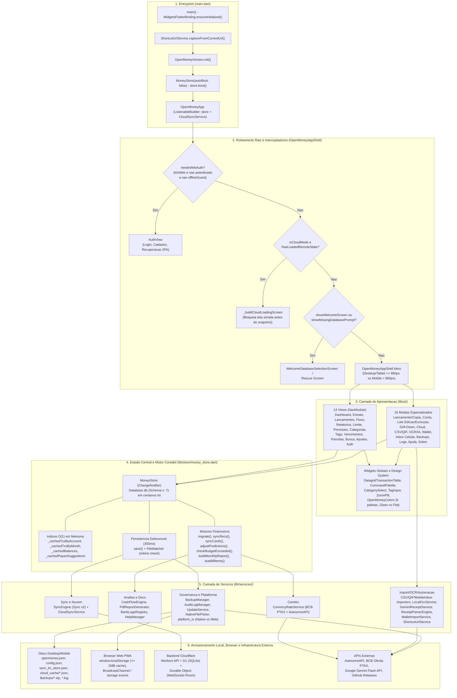

### Regras Estruturais da Camada de Apresentação e Bootstrap

- **Responsividade e Breakpoints ([`app_shell.dart`](file:///Users/fabiano/Developer/OpenMoneyFlutter/lib/ui/app_shell.dart)):**
  - `width >= 860`: layout Desktop/Tablet com barra lateral fixa (`285px` no modo `expanded`, `64px` no modo `miniRail`, ou oculta via `isSidebarVisible == false` exibindo botão flutuante `Menu`) e `_buildDesktopTopBar` com breadcrumbs, busca `Cmd/Ctrl + K` e pílula de zoom.
  - `width < 860`: layout Mobile com `AppBar` e `Drawer` lateral.
  - `width < 760` no primeiro frame: força navegação inicial para `NavModule.dashboard` (cockpit responsivo), respeitando também `store.startupView == 'dashboard'`.
- **Escala de Texto e Acessibilidade (`main.dart` e `money_store.dart`):**
  - `fontScale` separa preferências independentes para Desktop (`fontScaleDesktop`) e Mobile (`fontScaleMobile`), aplicadas globalmente via `MediaQuery.textScaler: TextScaler.linear(store.fontScale)` em [`main.dart`](file:///Users/fabiano/Developer/OpenMoneyFlutter/lib/main.dart#L134-L138).
- **Design System ([`liquid_glass.dart`](file:///Users/fabiano/Developer/OpenMoneyFlutter/lib/ui/theme/liquid_glass.dart)):**
  - **6 paletas de destaque (`accentPalettes`):** `sky` (Azul Oceano), `emerald` (Esmeralda Financeiro), `indigo` (Índigo Violeta), `orange` (Sunset Laranja), `cyan` (Ciano Futurista), `slate` (Titanium Slate).
  - **Estilos de superfície:** `Liquid Glass` (transparências com alfa e borda `borderGlass`) vs. `Flat Clean` (`isFlatClean: true`), ambos com suporte a temas Claro e Escuro e propagação uniforme para `ColorScheme.fromSeed`, `OutlinedButton`, `FilledButton`, `SegmentedButton` e `ChipTheme` sem resíduos de cor padrão do Material 3.
- **Proteção contra tela zerada no boot (`app_shell.dart` linhas 156–168):**
  - Enquanto `store.isCloudMode && CloudSyncService.instance.isAuthenticated && !SyncEngine.instance.hasLoadedRemoteState`, a casca renderiza `_buildCloudLoadingScreen` em vez de mostrar uma conta corrente vazia.

---

## 2. Diagrama de Classes e Modelo de Dados (Schema v: 7)

Todos os valores monetários são modelados estritamente em **centavos inteiros (`int`)** na menor unidade da moeda da conta, eliminando desvios de ponto flutuante IEEE-754. As definições residem em [`openmoney_models.dart`](file:///Users/fabiano/Developer/OpenMoneyFlutter/lib/models/openmoney_models.dart) e [`prediction_models.dart`](file:///Users/fabiano/Developer/OpenMoneyFlutter/lib/models/prediction_models.dart).

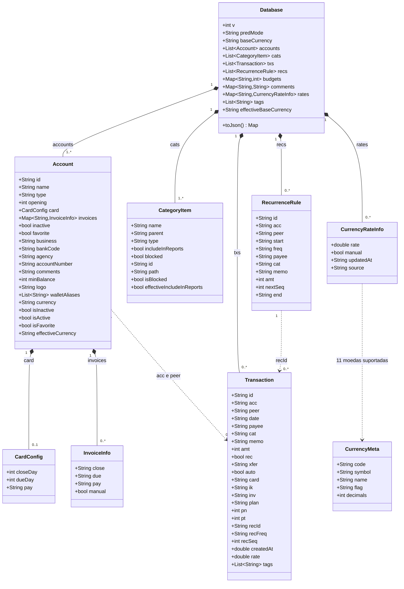

### Estruturas Analíticas, Orçamentárias e de Lote

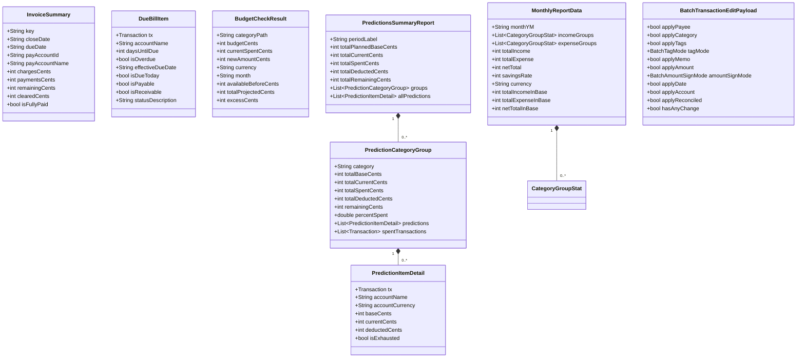

### Constantes e Catálogos Canônicos (`openmoney_models.dart`)

- **Tipos de conta (`kAccountTypes`):** `"Corrente"`, `"Poupança"`, `"Cartão de crédito"` (`kCardType`), `"Investimento"`, `"Dinheiro"`.
- **Separador hierárquico de categorias (`kCategorySep`):** `" › "` (máximo de 2 níveis: Pai e Subcategoria). Categorias com `"transferencia"` no nome retornam `effectiveIncludeInReports == false` por padrão quando `includeInReports == null`.
- **11 moedas suportadas (`kSupportedCurrencies`):** `BRL` (2 casas), `USD` (2), `EUR` (2), `CAD` (2), `AUD` (2), `GBP` (2), `PYG` (0 casas quando centavos zerados), `ARS` (2), `UYU` (2), `CHF` (2), `CLP` (0 casas quando centavos zerados), com taxas de fallback em `kFallbackRatesBrl`.
- **Identificação de transações automáticas e geradas:**
  - Previsões: `isPredictionPayee(payee)` — `removeDiacritics(payee).trim().toLowerCase().startsWith('previsao')`.
  - Fatura automática de cartão: `auto == true`, `id = 'inv:$cardId:$k:c'` (crédito no cartão) e `'inv:$cardId:$k:p'` (débito na conta pagadora), `xfer = 'inv:$cardId:$k'`, `card = cardId`, `inv = k`.
  - Parcelamentos: `plan = pid`, `pn = 1..count`, `pt = count`, sufixo `" ($pn/$pt)"` no `payee`.
  - Recorrências: `id = 'rec:${r.id}:$seq'` (e `'rec:${r.id}:$seq:peer'` + `xfer = 'xrec:${r.id}:$seq'` quando transferência), `recId = r.id`, `recFreq = r.freq`, `recSeq = seq`.

---

## 3. Ciclo de Boot, Modos de Operação e Blindagem Anti-Wipe em 3 Camadas

O processo de inicialização em [`MoneyStore.boot()`](file:///Users/fabiano/Developer/OpenMoneyFlutter/lib/store/money_store.dart#L953-L1162) e a persistência multiplataforma em [`platform_io_native.dart`](file:///Users/fabiano/Developer/OpenMoneyFlutter/lib/services/platform_io_native.dart) / [`platform_io_web.dart`](file:///Users/fabiano/Developer/OpenMoneyFlutter/lib/services/platform_io_web.dart) garantem recuperação segura após atualizações e proteção contra perda acidental de dados.

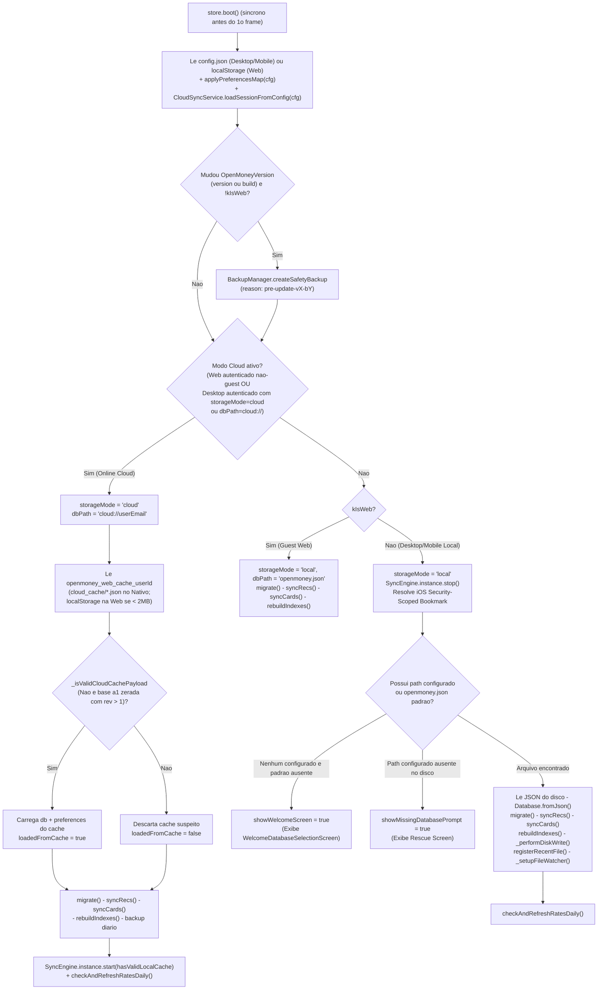

### Arquitetura da Blindagem Anti-Wipe em 3 Camadas

```mermaid
flowchart LR
  subgraph L1["Camada 1: Guarda Pre-Carga e Desconexao (Cliente)"]
    A1["AppShell bloqueia UI ate\nSyncEngine.hasLoadedRemoteState == true"]
    A2["_applyIncomingDelta() rejeita deltas pre-carga\ne dispara syncNow(forceFullPull: true)"]
    A3["disconnectLocalDatabase() chama\nSyncEngine.instance.stop() obrigatoriamente"]
  end

  subgraph L2["Camada 2: Bloqueio de Payload Vazio Suspeito (Cliente)"]
    B1["SyncEngine._isSuspiciousEmptyDb(db)\nBloqueia onLocalSave() e _scheduleClientCompaction()\nse txs vazio com baseline/revision > 1"]
    B2["SyncEngine._applyFullSnapshot()\nAborta se local >= 10 txs e remoto 0 txs / rev 0"]
    B3["CloudSyncService._executePushDatabase()\nBloqueia PUT /api/db vazio se rev > 1 e !force"]
    B4["MoneyStore._performDiskWrite()\nBackupManager.assertSafeDatabaseMutation()\nbloqueia sobrescrita destrutiva em disco"]
  end

  subgraph L3["Camada 3: Validacao no Backend (Cloudflare Worker)"]
    C1["PUT /api/db\nRejeita com HTTP 409 Conflict qualquer payload\nou compactSeq < 50 KB sobre base chunked:*\nsem header X-OpenMoney-Force: true"]
  end

  L1 --> L2 --> L3
```

- **Isolamento do Cache Cloud e Escrita Atômica ([`platform_io_native.dart`](file:///Users/fabiano/Developer/OpenMoneyFlutter/lib/services/platform_io_native.dart#L60-L179)):**
  - No Desktop e Mobile, chaves grandes (`openmoney_web_cache_*` e `openmoney_web_guest_db`) são redirecionadas automaticamente para arquivos dedicados em `<AppSupportDir>/cloud_cache/<key>.json` (sem o limite de 2 MB do `localStorage`), mantendo apenas metadados leves (`seq`, `outbox`) em `sync_kv_store.json`.
  - Toda gravação em `sync_kv_store.json` e `cloud_cache/` usa `_atomicWriteStringSync`: grava em `<target>.tmp.<pid>` com `flush: true` e aplica `renameSync(target.path)`.

---

## 4. Motor de Sincronização Granular em Tempo Real (`SyncEngine` — Sync v2)

O [`SyncEngine`](file:///Users/fabiano/Developer/OpenMoneyFlutter/lib/services/sync_engine.dart) rastreia 10 coleções determinísticas (`accounts/<id>`, `cats/<id>`, `txs/<id>`, `recs/<id>`, `budgets/<cat>`, `comments/<period>`, `tags/<tag>`, `meta/predMode`, `meta/accountOrder`, `prefs/userPrefs`), mantendo um `_baseline` local e uma fila persistente `_outbox` para operar tanto offline quanto em tempo real via WebSocket + HTTP.

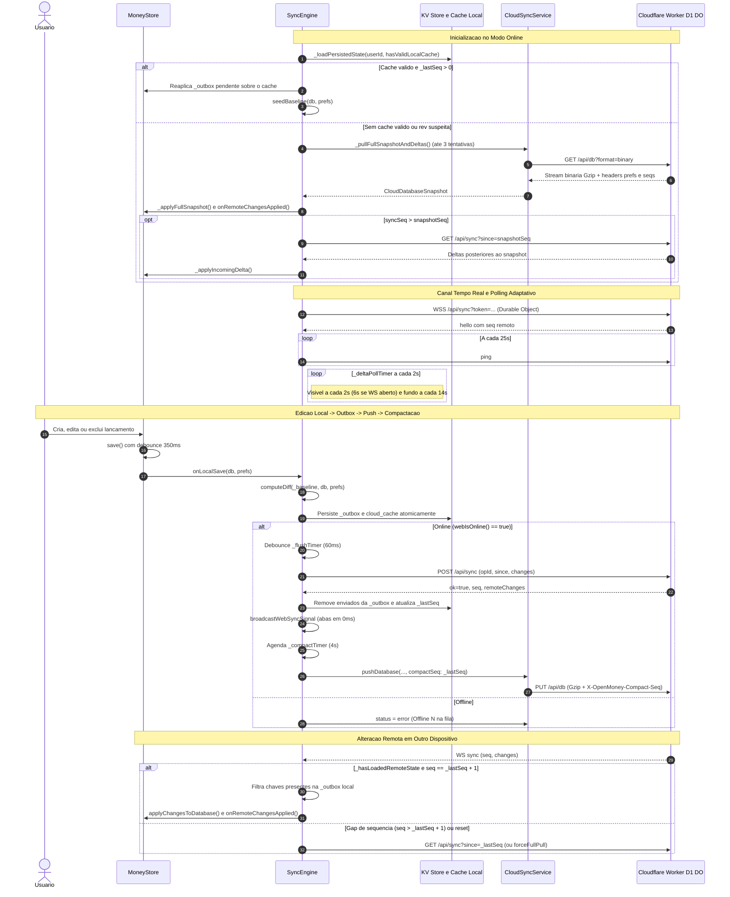

### Máquina de Estados da Conexão e Sincronização

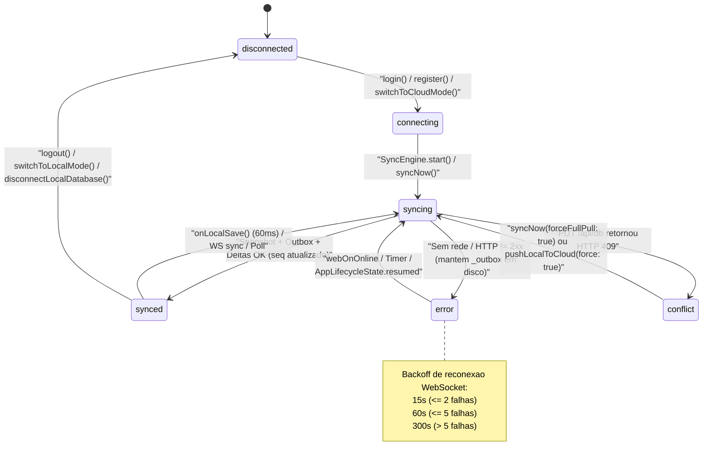

---

## 5. Regras de Negócio: Cartão de Crédito, Competência `ik` e Quitação (`syncCards`)

O modelo de faturas adotado no **Schema `v: 7`** garante que a chave de competência `ik` (`YYYY-MM`) corresponda sempre ao **mês de vencimento** da fatura (mesmo quando a fatura fecha no final do mês anterior). As funções puras residem em [`openmoney_models.dart`](file:///Users/fabiano/Developer/OpenMoneyFlutter/lib/models/openmoney_models.dart#L1653-L1715) e a consolidação em [`MoneyStore.syncCards()`](file:///Users/fabiano/Developer/OpenMoneyFlutter/lib/store/money_store.dart#L2827-L3005).

```mermaid
flowchart TD
  subgraph KeyCalc["1. Calculo da Chave de Fatura (invKeyFor) e Datas (invDates)"]
    K1["Entrada: CardConfig (closeDay, dueDay, pay) e date (YYYY-MM-DD)"]
    K2{"date.day > closeDay?"}
    K3["closeMonth = addMonthsYM(YYYY-MM, +1)"]
    K4["closeMonth = YYYY-MM"]
    K5{"dueDay <= closeDay?\n(Vence no mes seguinte ao fechamento)"}
    K6["ik = addMonthsYM(closeMonth, +1)"]
    K7["ik = closeMonth"]
    K8["invDates(card, ik):\ncloseKey = (dueDay <= closeDay) ? addMonthsYM(ik, -1) : ik\nclose = closeKey + dayIn(closeDay)\ndue = ik + dayIn(dueDay)"]

    K1 --> K2
    K2 -- Sim --> K3 --> K5
    K2 -- Nao --> K4 --> K5
    K5 -- Sim --> K6 --> K8
    K5 -- Nao --> K7 --> K8
  end

  subgraph Vigencia["2. Regra de Vigencia (isVigenteInvoice — ADR 003 / 005)"]
    V1["currentOpenKey = invKeyFor(cardCfg, today)"]
    V2{"invoiceKey == currentOpenKey?"}
    V3["VIGENTE = true\n(Fatura aberta do ciclo atual)"]
    V4{"closeDate <= today AND\ndueDate >= today?"}
    V5["VIGENTE = true\n(Fatura fechada aguardando vencimento)"]
    V6["VIGENTE = false\n(Fatura passada — nao gera falso atraso em DueBills)"]

    V1 --> V2
    V2 -- Sim --> V3
    V2 -- Nao --> V4
    V4 -- Sim --> V5
    V4 -- Nao --> V6
  end

  subgraph Reconcile["3. Consolidacao Idempotente de Faturas (syncCards)"]
    S1["Para cada conta tipo 'Cartao de credito' com CardConfig"]
    S2["Atualiza metadados em Account.invoices[k]\n(Respeita manual == true; recalcula automaticos)"]
    S3["Para cada lancamento nao-auto do cartao:\ngarante tx.ik = invKeyFor(card, date)\ne acumula sums[ik] += tx.amt"]
    S4{"Para cada fatura k:\nsums[k] < 0 E\nconta pagadora inv.pay existe?"}
    S5["Saldo Devedor Restante: amt = sums[k].abs()\nUpsert par espelhado com xfer = 'inv:cardId:k' e auto = true:\n1) 'inv:cardId:k:c' no Cartao (+amt)\n2) 'inv:cardId:k:p' na Conta Pagadora (-amt)\ndata = inv.due, rec = shouldSettle"]
    S6["Remove transacoes automaticas 'inv:cardId:k' e 'invpay:cardId:k'\n(invoiceSummary - isFullyPaid = true / LIQUIDADA)"]

    S1 --> S2 --> S3 --> S4
    S4 -- Sim --> S5
    S4 -- "Nao (Quitada ou sem conta pagadora)" --> S6
  end
```

### Regras Complementares de Cartão de Crédito

- **Migração Legada (`migrate()` em `money_store.dart` linhas 2637–2692):** bases com `db.v < 7` que possuam cartões com `dueDay <= closeDay` têm suas chaves de `Account.invoices`, `tx.ik`, `tx.inv`, `tx.xfer` (`inv:cardId:ik`) e `tx.id` migradas automaticamente do mês de fechamento para o mês de vencimento (`addMonthsYM(oldK, 1)`), gravando `db.v = 7`.
- **Pagamento Manual Parcial ou Antecipado (`payInvoice()`):** cria transferência espelhada entre a conta pagadora (`-debitCents`, convertendo moeda se diferente do cartão) e a conta cartão (`+amountCents` vinculado a `ik: invoiceKey`). Em seguida chama `syncCards()`, que automaticamente recalcula o saldo devedor remanescente e ajusta (ou remove, se zerado) o lançamento automático `inv:cardId:ik`.
- **Edição do Lançamento Automático de Fatura (`updateTransaction()`):** ao editar a data ou conta pagadora de uma transação `auto == true`, os dados não são editados diretamente na transação; o sistema grava `inv.due = newDate`, `inv.pay = newAccId` e `inv.manual = true` em `Account.invoices[inv]` e reexecuta `syncCards()`.
- **Previsão de Saldo do Cartão (`rebuildIndexes()`):** no cálculo do saldo previsto (`predByAcc`), lançamentos manuais do cartão entram se `ik <= _month`; já os lançamentos `auto == true` só entram no saldo previsto do cartão e da conta pagadora se estiverem conciliados (`tx.rec`) — evitando dupla contagem de despesas futuras do próprio cartão.

---

## 6. Regras de Negócio: Recorrências (`syncRecs`), Parcelamentos e Escopo (`ScopeChoice`)

O motor de recorrências ([`syncRecs()`](file:///Users/fabiano/Developer/OpenMoneyFlutter/lib/store/money_store.dart#L2695-L2825)) materializa ocorrências futuras de `RecurrenceRule` até um horizonte adaptativo por frequência, enquanto [`addTransaction()`](file:///Users/fabiano/Developer/OpenMoneyFlutter/lib/store/money_store.dart#L3878-L4075), [`updateTransaction()`](file:///Users/fabiano/Developer/OpenMoneyFlutter/lib/store/money_store.dart#L4175-L4434) e [`deleteTransaction()`](file:///Users/fabiano/Developer/OpenMoneyFlutter/lib/store/money_store.dart#L4436-L4500) governam parcelamentos, transferências recorrentes e edição/exclusão em série.

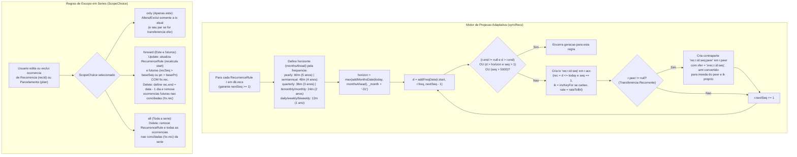

### Regras de Parcelamentos e Edição/Exclusão em Lote

- **Parcelamento (`mode == 'installment'`):**
  - Quantidade limitada ao intervalo `2..120` parcelas.
  - Divisão exata em centavos inteiros via `splitAmt(signedAmt, count)`: distribui o resto `r` (1 centavo por parcela inicial) para que a soma das parcelas seja idêntica ao valor total sem perda de centavos.
  - Somente a 1ª parcela (`i == 0`) recebe `rec = true` quando `d <= today`; parcelas futuras nascem não conciliadas.
  - Para compras parceladas em moeda estrangeira, a taxa histórica `rate` é gravada apenas nas parcelas cuja data seja `<= today`.
- **Copiar Lançamento como Novo (`_TransactionCopyDialog`):**
  - Bloqueado para lançamentos automáticos de fatura (`auto == true`).
  - Remove sufixos de parcela `(x/y)` do favorecido, mantém categoria/transferência, tags, nota e valor, e inicializa a data com `todayISO()` sem modificar o registro original.
- **Edição em Massa ([`batchUpdateTransactions()`](file:///Users/fabiano/Developer/OpenMoneyFlutter/lib/store/money_store.dart#L5981-L6102)):**
  - Ignora obrigatoriamente lançamentos `auto == true`.
  - Em transferências (`xfer != null || peer != null`), protege e bloqueia alteração em lote de **Categoria**, **Conta** e **Valor** para preservar o vínculo contábil espelhado.
  - Suporta atualização seletiva por checkbox de `Favorecido`, `Categoria`, `Tags` (`add`, `replace`, `remove`), `Nota`, `Valor` (`keepOriginal`, `expense`, `income`), `Data`, `Conta` e `Conciliação`, recalculando `ik` para cartões quando conta/data mudarem e registrando `AuditAction.batchEdit`.
- **Exclusão em Lote ([`batchDeleteTransactionsByIds()`](file:///Users/fabiano/Developer/OpenMoneyFlutter/lib/store/money_store.dart#L6104-L6157) e [`executeBatchDelete()`](file:///Users/fabiano/Developer/OpenMoneyFlutter/lib/store/money_store.dart#L4564-L4631)):**
  - Ignora `auto == true`; expande automaticamente a remoção para contrapartes `xfer` vinculadas (opcional no utilitário por período).
  - Cria obrigatoriamente backup preventivo (`createSafetyBackup` / `createAutomaticPreDeleteBackup`) no Desktop/Mobile antes de excluir e grava evento `AuditAction.batchDelete`.

---

## 7. Regras de Negócio: Previsões Orçamentárias e Limite de Gastos

O sistema combina dois mecanismos proativos de planejamento: o **Abatimento Inteligente de Previsões** ([`adjustPredictions()`](file:///Users/fabiano/Developer/OpenMoneyFlutter/lib/store/money_store.dart#L4642-L4850) + [`PredictionsManagementView`](file:///Users/fabiano/Developer/OpenMoneyFlutter/lib/ui/views/predictions_management_view.dart)) e a **Verificação Ativa de Limite de Gastos** ([`checkBudgetExceeded()`](file:///Users/fabiano/Developer/OpenMoneyFlutter/lib/store/money_store.dart#L3778-L3874)).

```mermaid
flowchart TD
  subgraph PredFlow["1. Abatimento de Previsoes (adjustPredictions e ADR 010 / 020)"]
    P1["Identifica previsoes no mes:\nisPredictionPayee(payee) == true\n(inicia com 'Previsao', sem acento/case) e auto != true"]
    P2{"Qual db.predMode?"}
    P3["'month' (Padrao):\nAvalia apenas targetMonth\nAbate gastos reais com t.date no mes\ne t.cat == cat"]
    P4["'invoice' (Por Fatura):\nAvalia janela [M, M+1, M+2]\nDespesas bancarias por t.date == m +\nCompras em cartao por (t.ik ?? invKeyFor) == m"]
    P5["Calcula netSpent = max(0, sum(|despesas|) - sum(estornos/creditos))"]
    P6["Recupera Base Original:\nparseBaseFromMemo(memo) ?? pred.amt.abs()\nPreserva tag '[Previsao base: R$ X,XX]' no memo"]
    P7["newRemaining = base - min(base, netSpent)"]
    P8{"newRemaining > 0?"}
    P9["Atualiza pred.amt = sign * newRemaining\nStatus: Ajustada ou Mantida"]
    P10["Retencao com Saldo Zerado (ADR 020):\nNAO exclui o registro!\npred.amt = 0 (R$ 0,00) + Status: ESGOTADA\n(Restauravel via restorePredictionBase)"]

    P1 --> P2
    P2 -- month --> P3 --> P5
    P2 -- invoice --> P4 --> P5
    P5 --> P6 --> P7 --> P8
    P8 -- Sim --> P9
    P8 -- Nao --> P10
  end

  subgraph BudgetFlow["2. Verificacao Ativa de Limite de Gastos (checkBudgetExceeded — ADR 021)"]
    B1["Disparado ao salvar despesa no Modal ou Barra Rapida"]
    B2{"signedAmt < 0 E !transferencia\nE !isPredictionPayee?"}
    B3["Ignora verificacao (retorna null)"]
    B4["Busca teto em db.budgets:\n1) teto direto db.budgets[catSelection]\n2) fallback para teto da categoria pai\n(se 'Pai > Filho' nao tiver teto proprio)"]
    B5{"Existe teto > 0?"}
    B6["Soma gastos reais do mes (t.amt < 0,\nnao-xfer, nao-auto, nao-previsao,\nisCategoryIncludedInReports) na baseCurrency"]
    B7["Calcula impacto da nova despesa:\nse parcelado, usa apenas 1a parcela (splitAmt[0])\nconvertida para baseCurrency"]
    B8{"currentSpent + newInBase > targetBudget?"}
    B9["Exibe Alerta Preventivo de Estouro\n(Orcado vs Gasto Atual vs Novo Gasto vs Excesso)\nPermite Cancelar ou Continuar"]
    B10["Grava lancamento normalmente"]

    B1 --> B2
    B2 -- Nao --> B3 --> B10
    B2 -- Sim --> B4 --> B5
    B5 -- Nao --> B3
    B5 -- Sim --> B6 --> B7 --> B8
    B8 -- Sim --> B9
    B8 -- Nao --> B10
    B9 -- Continuar --> B10
  end
```

---

## 8. Regras de Negócio: Multi-Moeda, Câmbio Histórico e Motores Analíticos

### Invariante Canônico de Câmbio e Resolução Histórica ([`CurrencyRateService`](file:///Users/fabiano/Developer/OpenMoneyFlutter/lib/services/currency_rate_service.dart) + [`MoneyStore`](file:///Users/fabiano/Developer/OpenMoneyFlutter/lib/store/money_store.dart#L238-L469))

- **Invariante universal (`Transaction.rate`):** armazena sempre a razão **`1 unidade da moeda da conta -> BRL`**, mesmo quando `db.baseCurrency` for diferente de `BRL` (ex.: `USD` ou `EUR`). A conversão para `baseCurrency` usa a razão cruzada `(txRateToBrl / rateToBrl(baseCurrency))` em `convertToBase()`.
- **Atualização diária automática (`checkAndRefreshRatesDaily()`):** executada no boot e na troca de `baseCurrency` apenas quando existir pelo menos uma conta ativa em moeda diferente de `baseCurrency` e respeitando o intervalo mínimo de 24h/virada do dia civil e cotações marcadas como `manual: true`.

```mermaid
flowchart TD
  subgraph RateRes["Resolucao de Taxa Historica (resolveDefaultRateToBrl)"]
    R1["Conta em moeda estrangeira (cur != 'BRL')"]
    R2{"Data da transacao\ne passada (< todayISO)?"}
    R3["1. Verifica ultima transferencia cambial\nna conta ate dateIso\n(lastTransferRateForAccount, prioriza entrada)"]
    R4{"Encontrou taxa de\ntransferencia?"}
    R5["2. Consulta cache historico\n(CurrencyRateService.cachedHistoricalRate)"]
    R6{"Cache encontrado\nou consulta assincrona\n(fetchHistoricalRateToBrl)?"}
    R7["2a. API OData BCB Olinda PTAX\n(janela de 7 dias anteriores p/ feriados/FDS)"]
    R8{"PTAX retornou?"}
    R9["2b. Fallback AwesomeAPI\n(/json/daily/CUR-BRL/10)"]
    R10["3. Fallback: Taxa vigente em db.rates[cur]\nou kFallbackRatesBrl[cur]"]

    R1 --> R2
    R2 -- "Nao (hoje/futuro)" --> R10
    R2 -- Sim --> R3 --> R4
    R4 -- Sim --> UseRate["Usa taxa resolvida"]
    R4 -- Nao --> R5 --> R6
    R6 -- "Cache Hit" --> UseRate
    R6 -- "Fetch Online" --> R7 --> R8
    R8 -- Sim --> UseRate
    R8 -- Nao --> R9 --> UseRate
    R9 -- Falha --> R10 --> UseRate
  end

  subgraph Engines["Comparativo Contabil: ReportsView vs CashFlowEngine"]
    E1["buildMonthlyReport (ReportsView)"]
    E2["Exclui TODAS as transferencias (xfer != null || peer != null)\nExclui categorias com includeInReports == false\nSuporta filtro de contas, status e #tag"]
    E3["CashFlowEngine (Fluxo de Caixa Matricial)"]
    E4{"Filtro de contas ativo?"}
    E5["Todas as Contas:\nExclui TODAS as transferencias entre contas"]
    E6["Contas Especificas selecionadas:\nExclui transferencia se contraparte TAMBEM estiver\nno filtro (interna ao grupo); MANTEM transferencia\nde/para conta fora do filtro para fechar saldo"]
    E7["Identidade contabil rigorosa:\nSaldo Anterior + Entradas - Saidas = Saldo Final Acumulado\n(Suporta escalas Diaria/Mensal/Trimestral/Semestral/Anual\ne modos Data da Compra vs Data da Fatura)"]

    E1 --> E2
    E3 --> E4
    E4 -- Nao --> E5 --> E7
    E4 -- Sim --> E6 --> E7
  end
```

---

## 9. Pipeline de Importação, OCR, IA e Resolução de Contas em 4 Níveis

O OpenMoney Flutter integra múltiplas vias de entrada automatizada de dados financeiros convergindo para o livro-razão (`MoneyStore`), com detecção de duplicidade, edição prévia em grade de revisão e arquivamento de comprovantes.

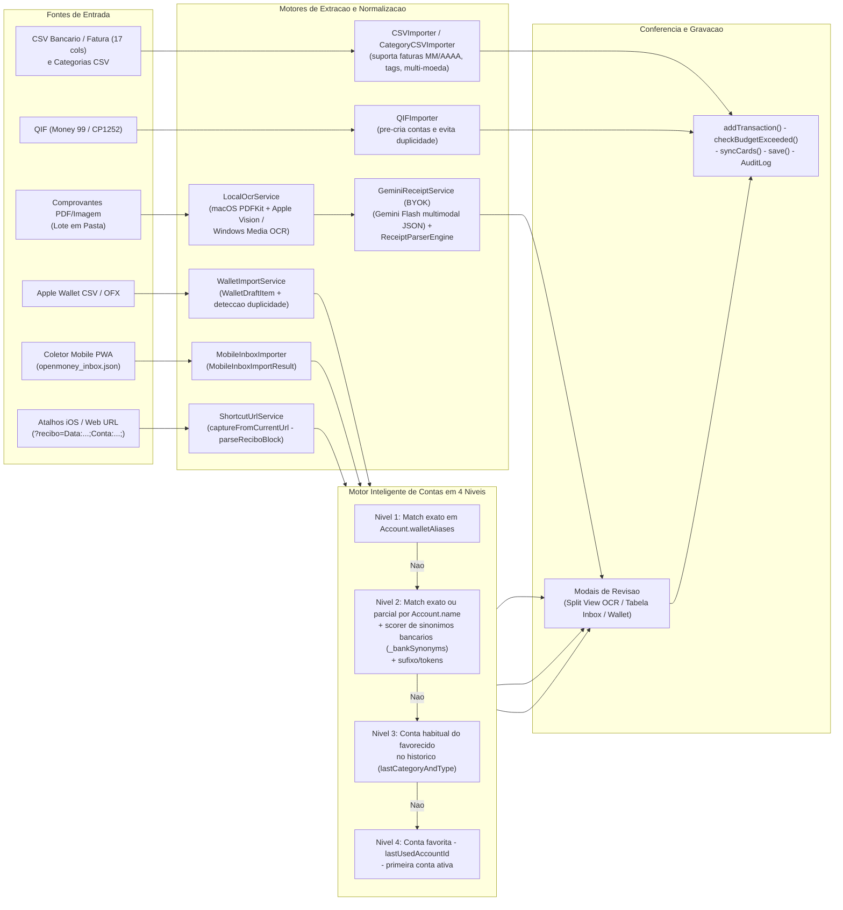

---

## 10. Inventário Completo de Módulos, Views, Modais, Serviços e Atalhos

### 10.1 Telas Principais (14 Views em `lib/ui/views/`)

| Enum `NavModule` / Rota | Componente | Arquivo | Responsabilidade Principal |
| :--- | :--- | :--- | :--- |
| `NavModule.dashboard` | `DashboardOverviewView` | [`dashboard_overview_view.dart`](file:///Users/fabiano/Developer/OpenMoneyFlutter/lib/ui/views/dashboard_overview_view.dart) | Grid configurável (1–3 colunas), reordenação de cards, privacidade isolada por card, Patrimônio, Contas, Investimentos, A Pagar/Receber, Faturas, Gastos por Categoria e Ações Rápidas. |
| `NavModule.account` | `AccountLedgerView` | [`account_ledger_view.dart`](file:///Users/fabiano/Developer/OpenMoneyFlutter/lib/ui/views/account_ledger_view.dart) | Extrato da conta ou fatura de cartão, barra rápida inline configurável, autocompletar de favorecidos, seletor `MonthYearQuickPicker`, alternância Lista Diária vs. Datagrid, exportação PDF A4. |
| `NavModule.transactions` | `AllTransactionsView` | [`all_transactions_view.dart`](file:///Users/fabiano/Developer/OpenMoneyFlutter/lib/ui/views/all_transactions_view.dart) | Visão consolidada multi-conta com filtro Dia/Mês/Ano, modo Data da Compra vs. Fatura, filtros combináveis (Conta, Categoria, Tag, Tipo, Conciliação, Busca), seleção múltipla e edição/exclusão em lote. |
| `NavModule.cashFlow` | `CashFlowView` | [`cash_flow_view.dart`](file:///Users/fabiano/Developer/OpenMoneyFlutter/lib/ui/views/cash_flow_view.dart) | Matriz de Fluxo de Caixa (Diário a Anual), filtro por contas e Negócio (`PF`/`PJ`), comentários por período, drill-down por célula e exportação CSV. |
| `NavModule.reports` | `ReportsView` | [`reports_view.dart`](file:///Users/fabiano/Developer/OpenMoneyFlutter/lib/ui/views/reports_view.dart) | Relatórios mensais e anuais por categoria, filtros por conta/negócio/status/`#tag`, subtotais históricos `≈` em moeda base, drill-down e PDF A4 em 1 página. |
| `NavModule.budget` | `BudgetView` | [`budget_view.dart`](file:///Users/fabiano/Developer/OpenMoneyFlutter/lib/ui/views/budget_view.dart) | Configuração de tetos mensais (`db.budgets`) por categoria/subcategoria e acompanhamento visual de consumo. |
| `NavModule.predictions` | `PredictionsManagementView` | [`predictions_management_view.dart`](file:///Users/fabiano/Developer/OpenMoneyFlutter/lib/ui/views/predictions_management_view.dart) | Cockpit dedicado de Previsões Orçamentárias: KPIs, progresso, drill-down de gastos que consumiram o teto, botão Ajustar e Restaurar Base. |
| `NavModule.categories` | `CategoriesView` | [`categories_view.dart`](file:///Users/fabiano/Developer/OpenMoneyFlutter/lib/ui/views/categories_view.dart) | Árvore de categorias em 2 níveis (` › `), bloqueio com propagação para filhas, flag `includeInReports` e substituição assistida na exclusão. |
| `NavModule.tags` | `TagsView` | [`tags_view.dart`](file:///Users/fabiano/Developer/OpenMoneyFlutter/lib/ui/views/tags_view.dart) | Catálogo global de `#tags` (`db.tags`), contagem de uso, criação, renomeação em massa e exclusão. |
| `NavModule.dueBills` | `DueBillsView` | [`due_bills_view.dart`](file:///Users/fabiano/Developer/OpenMoneyFlutter/lib/ui/views/due_bills_view.dart) | Vencimentos a pagar e receber dentro de `reminderDaysAhead`, com classificação (`ATRASADO`, `Vence Hoje`, `Vence em X dias`), conciliação em lote e exportação CSV. |
| `NavModule.installments` | `InstallmentsView` | [`installments_view.dart`](file:///Users/fabiano/Developer/OpenMoneyFlutter/lib/ui/views/installments_view.dart) | Painel de despesas parceladas em aberto (`pn/pt`, `plan != null`), saldo restante e progresso por plano. |
| `NavModule.search` | `GlobalSearchView` | [`global_search_view.dart`](file:///Users/fabiano/Developer/OpenMoneyFlutter/lib/ui/views/global_search_view.dart) | Busca textual global diacrítico-insensível em favorecido, categoria, memo, tag e valor, com navegação direta para a conta/mês do registro. |
| `NavModule.settings` | `SettingsView` | [`settings_view.dart`](file:///Users/fabiano/Developer/OpenMoneyFlutter/lib/ui/views/settings_view.dart) | Central de Ajustes: tela inicial, widgets e filtros do dashboard, ordenação, densidade, estilo Glass/Flat, 6 paletas, zoom, Moedas & Cotações (*Corrigir Passados*) e chave Gemini BYOK. |
| *(Gate Web)* | `AuthView` | [`auth_view.dart`](file:///Users/fabiano/Developer/OpenMoneyFlutter/lib/ui/views/auth_view.dart) | Autenticação Web PWA: login, criação de conta, recuperação de senha com código de 6 dígitos e acesso opcional ao modo local no navegador. |

### 10.2 Modais Especializados (16 Arquivos em `lib/ui/modals/`)

| Modal | Arquivo | Função |
| :--- | :--- | :--- |
| Lançamento (Criar/Editar/Copiar/Câmbio) | [`transaction_modal.dart`](file:///Users/fabiano/Developer/OpenMoneyFlutter/lib/ui/modals/transaction_modal.dart) | Inclui `_TransactionCreateDialog`, `_TransactionEditDialog`, `_TransactionCopyDialog`, `_CrossCurrencyTransferBox`, `_ForeignTransactionRateBox` e verificação de limite (`checkBudgetExceeded`). |
| Cadastro e Edição de Contas | [`account_modal.dart`](file:///Users/fabiano/Developer/OpenMoneyFlutter/lib/ui/modals/account_modal.dart) | Configuração de tipo, moeda, saldo inicial, `CardConfig` (`closeDay`, `dueDay`, `pay`), negócio (`PF`/`PJ`), logo bancário e `walletAliases`. |
| Filtro Multiconta / Negócio | [`account_multi_select_filter.dart`](file:///Users/fabiano/Developer/OpenMoneyFlutter/lib/ui/modals/account_multi_select_filter.dart) | Seleção múltipla de contas e agrupamentos por negócio para Relatórios, Fluxo de Caixa e Vencimentos. |
| Edição em Massa | [`batch_edit_transactions_modal.dart`](file:///Users/fabiano/Developer/OpenMoneyFlutter/lib/ui/modals/batch_edit_transactions_modal.dart) | Aplicação seletiva de alterações em lote sobre os registros marcados na tela consolidada. |
| Exclusão em Lote por Período/Conta | [`batch_delete_modal.dart`](file:///Users/fabiano/Developer/OpenMoneyFlutter/lib/ui/modals/batch_delete_modal.dart) | Pré-visualização de impacto (`BatchDeletePreview`), backup preventivo automático e limpeza em lote. |
| Drill-Down de Categoria/Célula | [`category_drill_down_modal.dart`](file:///Users/fabiano/Developer/OpenMoneyFlutter/lib/ui/modals/category_drill_down_modal.dart) | Detalhamento de lançamentos por categoria/mês/ano/tudo com filtro de conciliação e exportação CSV. |
| Conta OpenMoney Cloud & Sync | [`cloud_account_modal.dart`](file:///Users/fabiano/Developer/OpenMoneyFlutter/lib/ui/modals/cloud_account_modal.dart) | Login, 2FA, troca de e-mail/senha, alternância entre múltiplas contas salvas, restauração de backups da nuvem, troca Local ↔ Cloud e ajuda Sync v2. |
| Central CSV & QIF | [`csv_qif_modal.dart`](file:///Users/fabiano/Developer/OpenMoneyFlutter/lib/ui/modals/csv_qif_modal.dart) | Importação e exportação de transações e categorias em CSV/QIF. |
| Importador de Recibos OCR + IA | [`receipt_ocr_import_modal.dart`](file:///Users/fabiano/Developer/OpenMoneyFlutter/lib/ui/modals/receipt_ocr_import_modal.dart) | Conferência em lote em Split View com OCR local + Gemini BYOK e arquivamento em `processados/`. |
| Importador Apple Wallet | [`wallet_import_modal.dart`](file:///Users/fabiano/Developer/OpenMoneyFlutter/lib/ui/modals/wallet_import_modal.dart) | Revisão de transações extraídas do Apple Wallet com aprendizado de `walletAliases`. |
| Inbox do Coletor Mobile | [`mobile_inbox_modal.dart`](file:///Users/fabiano/Developer/OpenMoneyFlutter/lib/ui/modals/mobile_inbox_modal.dart) | Importação e conferência de `openmoney_inbox.json` exportado pelo Coletor Mobile PWA. |
| Histórico de Backups | [`backups_history_modal.dart`](file:///Users/fabiano/Developer/OpenMoneyFlutter/lib/ui/modals/backups_history_modal.dart) | Listagem, criação manual e restauração de snapshots `.zip` locais. |
| Logs de Auditoria | [`audit_logs_modal.dart`](file:///Users/fabiano/Developer/OpenMoneyFlutter/lib/ui/modals/audit_logs_modal.dart) | Consulta aos últimos eventos registrados localmente (`*.log`) e no D1 (`user_audit_logs`). |
| Boas-Vindas & Gerenciador de Arquivo | [`welcome_database_modal.dart`](file:///Users/fabiano/Developer/OpenMoneyFlutter/lib/ui/modals/welcome_database_modal.dart) | Onboarding de primeira execução (criar base local, abrir `.json` existente ou conectar ao OpenMoney Cloud). |
| Ajuda Integrada | [`help_modal.dart`](file:///Users/fabiano/Developer/OpenMoneyFlutter/lib/ui/modals/help_modal.dart) | Leitor do `README.md` com renderização de blocos Markdown estruturados via `HelpManager`. |
| Sobre o OpenMoney | [`about_modal.dart`](file:///Users/fabiano/Developer/OpenMoneyFlutter/lib/ui/modals/about_modal.dart) | Exibe versão semântica, número de build, links e créditos. |

### 10.3 Widgets Globais e Serviços

- **Widgets (`lib/ui/widgets/`):** [`datagrid_transaction_table.dart`](file:///Users/fabiano/Developer/OpenMoneyFlutter/lib/ui/widgets/datagrid_transaction_table.dart), [`command_palette_modal.dart`](file:///Users/fabiano/Developer/OpenMoneyFlutter/lib/ui/widgets/command_palette_modal.dart), [`category_select_form_field.dart`](file:///Users/fabiano/Developer/OpenMoneyFlutter/lib/ui/widgets/category_select_form_field.dart), [`tag_input_field.dart`](file:///Users/fabiano/Developer/OpenMoneyFlutter/lib/ui/widgets/tag_input_field.dart), [`zoom_control_pill.dart`](file:///Users/fabiano/Developer/OpenMoneyFlutter/lib/ui/widgets/zoom_control_pill.dart), [`csv_export.dart`](file:///Users/fabiano/Developer/OpenMoneyFlutter/lib/ui/widgets/csv_export.dart).
- **Serviços (`lib/services/`):** [`sync_engine.dart`](file:///Users/fabiano/Developer/OpenMoneyFlutter/lib/services/sync_engine.dart), [`cloud_sync_service.dart`](file:///Users/fabiano/Developer/OpenMoneyFlutter/lib/services/cloud_sync_service.dart), [`cash_flow_engine.dart`](file:///Users/fabiano/Developer/OpenMoneyFlutter/lib/services/cash_flow_engine.dart), [`currency_rate_service.dart`](file:///Users/fabiano/Developer/OpenMoneyFlutter/lib/services/currency_rate_service.dart), [`importers_exporters.dart`](file:///Users/fabiano/Developer/OpenMoneyFlutter/lib/services/importers_exporters.dart), [`local_ocr_service.dart`](file:///Users/fabiano/Developer/OpenMoneyFlutter/lib/services/local_ocr_service.dart), [`receipt_parser_engine.dart`](file:///Users/fabiano/Developer/OpenMoneyFlutter/lib/services/receipt_parser_engine.dart), [`gemini_receipt_service.dart`](file:///Users/fabiano/Developer/OpenMoneyFlutter/lib/services/gemini_receipt_service.dart), [`wallet_import_service.dart`](file:///Users/fabiano/Developer/OpenMoneyFlutter/lib/services/wallet_import_service.dart), [`shortcut_url_service.dart`](file:///Users/fabiano/Developer/OpenMoneyFlutter/lib/services/shortcut_url_service.dart), [`backup_manager.dart`](file:///Users/fabiano/Developer/OpenMoneyFlutter/lib/services/backup_manager.dart), [`audit_log_manager.dart`](file:///Users/fabiano/Developer/OpenMoneyFlutter/lib/services/audit_log_manager.dart), [`pdf_report_generator.dart`](file:///Users/fabiano/Developer/OpenMoneyFlutter/lib/services/pdf_report_generator.dart), [`bank_logo_registry.dart`](file:///Users/fabiano/Developer/OpenMoneyFlutter/lib/services/bank_logo_registry.dart), [`help_manager.dart`](file:///Users/fabiano/Developer/OpenMoneyFlutter/lib/services/help_manager.dart), [`update_service.dart`](file:///Users/fabiano/Developer/OpenMoneyFlutter/lib/services/update_service.dart), [`native_file_picker.dart`](file:///Users/fabiano/Developer/OpenMoneyFlutter/lib/services/native_file_picker.dart), [`platform_io.dart`](file:///Users/fabiano/Developer/OpenMoneyFlutter/lib/services/platform_io.dart), [`platform_io_native.dart`](file:///Users/fabiano/Developer/OpenMoneyFlutter/lib/services/platform_io_native.dart), [`platform_io_web.dart`](file:///Users/fabiano/Developer/OpenMoneyFlutter/lib/services/platform_io_web.dart).

### 10.4 Atalhos de Teclado Globais (`CallbackShortcuts` em `app_shell.dart`)

| Atalho (macOS / Windows & Linux) | Ação Executada |
| :--- | :--- |
| `Cmd + K` / `Ctrl + K` | Abre o `CommandPalette` (busca e navegação rápida) |
| `Cmd + ,` / `Ctrl + ,` | Navega para `NavModule.settings` (Ajustes & Personalização) |
| `Cmd + Shift + F` / `Ctrl + Shift + F` | Navega para `NavModule.search` (Pesquisa Global) |
| `Cmd + Option + I` / `Ctrl + Alt + I` | Abre a Central CSV & QIF (`showCsvQifCenterModal`) |
| `Cmd + O` / `Ctrl + O` | Abre o Gerenciador de Arquivo da Base Local (`showDatabaseFileManagerModal`) |
| `Cmd + Shift + B` / `Ctrl + Shift + B` | Abre o Histórico de Backups (`showBackupsHistoryModal`) |
| `Cmd + Shift + L` / `Ctrl + Shift + L` | Abre os Logs de Auditoria (`showAuditLogsModal`) |
| `Cmd + B` / `Ctrl + B` | Alterna Sidebar entre `expanded` (`285px`) e `miniRail` (`64px`) |
| `Cmd + +` / `Cmd + -` / `Cmd + 0` *(ou `Ctrl`)* | Zoom In (`zoomIn`), Zoom Out (`zoomOut`) e Reset (`resetZoom`) |
| `F1` ou `Cmd/Ctrl + Shift + /` | Abre o Manual de Ajuda integrado (`showHelpModal`) |
