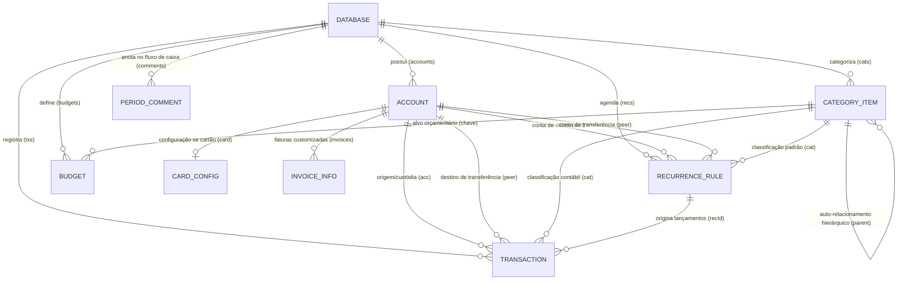

# 📖 Dicionário de Dados Completo - OpenMoney (Schema v: 7)

> **Versão do Schema:** `v: 7`  
> **Status:** Canônico e Homologado  
> **Repositórios:** OpenMoneySwift & OpenMoneyFlutter  
> **Arquivo da Base de Dados:** `openmoney.json`  
> **Idioma:** Português (Brasil)  

---

## 📌 1. Visão Geral e Princípios Fundamentais

O **OpenMoney** utiliza uma base de dados local, autônoma e descentralizada estruturada no formato JSON (`openmoney.json`). Todas as plataformas do ecossistema (macOS, iOS, Windows, Web, Android) operam diretamente sobre esse schema unificado.

### Princípios Contábeis e Técnicos do Schema:
1. **Rigor Monetário em Centavos Inteiros (`Int` / `int`):**
   Todos os valores monetários (`amt`, `opening`, `limit`, limites de gastos, etc.) são armazenados estritamente como números inteiros representando centavos (ex: `R$ 1.250,50` é gravado como `125050`; despesa de `R$ 49,90` como `-4990`). Isso elimina erros de imprecisão e arredondamento de frações binárias (IEEE-754).
2. **Formato de Datas ISO 8601:**
   Datas completas seguem o padrão `YYYY-MM-DD` (ex: `2026-11-02`). Competências e faturas seguem o padrão `YYYY-MM` (ex: `2026-11`).
3. **Persistência Atômica com Debounce:**
   Gravações em disco ocorrem com debounce de 350ms, criando arquivo temporário seguro antes da substituição atômica, acompanhado de backup diário versionado.

---

## 🗺️ 2. Diagrama Entidade-Relacionamento (ERD)



---

## 🗄️ 3. Raiz da Base de Dados (`Database`)

Estrutura principal do arquivo `openmoney.json`.

| Campo | Tipo | Obrigatório | Valor Padrão | Descrição / Finalidade | Relacionamento |
| :--- | :--- | :---: | :--- | :--- | :--- |
| `v` | `Int` | Sim | `7` | Versão do schema de dados. Permite que os leitores executem migrações automáticas e validem compatibilidade entre clientes. | — |
| `accounts` | `List<Account>` | Sim | `[Conta Corrente]` | Lista de todas as contas financeiras cadastradas pelo usuário (bancos, carteiras, cartões). | 1:N com `Account` |
| `cats` | `List<CategoryItem>` | Sim | `DEFAULT_CATS` | Árvore de categorias e subcategorias contábeis de receitas e despesas. | 1:N com `CategoryItem` |
| `txs` | `List<Transaction>` | Sim | `[]` | Livro-razão contábil contendo todas as transações financeiras (efetivadas, conciliadas e automáticas). | 1:N com `Transaction` |
| `recs` | `List<RecurrenceRule>` | Sim | `[]` | Regras ativas de despesas, receitas e transferências recorrentes programadas. | 1:N com `RecurrenceRule` |
| `budgets` | `Map<String, Int>` | Sim | `{}` | Mapeamento de limite de gastos mensais planejados por categoria, onde a chave é o `path` da categoria e o valor é o teto em centavos. | Chave mapeia para `CategoryItem.path` |
| `comments` | `Map<String, String>` | Não | `{}` | Dicionário de comentários e anotações do usuário na linha "Saldo Final Acumulado" do Fluxo de Caixa, indexado pela chave do período (`YYYY-MM`, `YYYY`, `YYYY-MM-DD`, etc.). Omitido do JSON quando vazio. | Chave mapeia para `CashFlowColumnDef.id` |
| `predMode` | `String` | Não | `"month"` | Modo de abatimento de lançamentos de previsão contra gastos reais: `"month"` (por mês de calendário) ou `"invoice"` (por ciclo de fatura de cartão). | — |
| `baseCurrency` | `String?` | Não | `"BRL"` | Moeda padrão/base de consolidação financeira do sistema (ex: `"BRL"`, `"USD"`, `"EUR"`). | Referencia catálogo `SUPPORTED_CURRENCIES` |
| `rates` | `Map<String, CurrencyRateInfo>?` | Não | `{}` | Cotações correntes persistidas em relação ao `BRL`, indexadas pelo código ISO da moeda (`"USD"`, `"EUR"`, etc.). | Contém `rate`, `updatedAt`, `manual` (e `source` opcional) |
| `tags` | `List<String>` | Não | `[]` | Catálogo global de tags personalizadas criadas pelo usuário (ou registradas ao salvar lançamentos). Omitido do JSON quando vazio. | Referenciado por `Transaction.tags` e Sync v2 (`tags/<nome>`) |

### 3.1. Estrutura de Cotação de Moeda (`CurrencyRateInfo`)

Objeto armazenado no mapa `Database.rates[code]`:

| Campo | Tipo | Obrigatório | Valor Padrão | Descrição / Finalidade |
| :--- | :--- | :---: | :--- | :--- |
| `rate` | `Double` | Sim | `1.0` | Valor de `1 unidade` da moeda estrangeira expresso em **BRL** (ex: `5.7512`). |
| `updatedAt` | `String` | Sim | `""` | Timestamp ISO 8601 da última atualização automática ou edição manual (exibido ao usuário e usado na regra de refresh de 24h). |
| `manual` | `Bool?` | Não | `false` | Quando `true`, protege a cotação contra sobrescrita pela atualização online automática diária. |
| `source` | `String?` | Não | `"AwesomeAPI"` | Origem informativa da cotação (`"AwesomeAPI"` ou `"Manual"` — opcional no JSON). |

---

## 🏦 4. Contas Financeiras (`Account`)

Representa qualquer custódia de valor monetário: conta corrente, carteira física, poupança, investimento ou cartão de crédito.

| Campo | Tipo | Obrigatório | Valor Padrão | Descrição / Para que serve | Relacionamento / Regras |
| :--- | :--- | :---: | :--- | :--- | :--- |
| `id` | `String` | Sim | `uid()` | Identificador único alfanumérico da conta (ex: `"acc-123"`, `"a1"`). | Chave primária referenciada por `Transaction.acc`, `Transaction.peer`, `CardConfig.pay`. |
| `name` | `String` | Sim | — | Nome de exibição da conta (ex: `"Itaú Personalité"`, `"Nubank Ultravioleta"`). | Exibição em telas e menus. |
| `type` | `String` | Sim | `"Corrente"` | Tipo de conta contábil. Valores permitidos: `"Corrente"`, `"Poupança"`, `"Cartão de crédito"`, `"Investimento"`, `"Dinheiro"`. | Define comportamento da interface e regras de balanço. |
| `opening` | `Int` | Sim | `0` | Saldo inicial de abertura da conta expresso em centavos inteiros. Pode ser negativo em contas de cartão de crédito legadas. | Adicionado ao somatório de transações para calcular o saldo atual. |
| `card` | `CardConfig?` | Não | `null` | Objeto contendo os parâmetros operacionais de fechamento e vencimento de fatura. | Presente exclusivamente quando `type == "Cartão de crédito"`. |
| `invoices` | `Map<String, InvoiceInfo>?` | Não | `null` | Dicionário de exceções e configurações personalizadas de faturas históricas, indexado por competência (`"YYYY-MM"`). | 1:N indexado por chave de competência (`ik`). |
| `inactive` | `Bool?` | Não | `false` | Indica se a conta foi inativada/arquivada pelo usuário. Contas inativas são ocultadas dos seletores de novos lançamentos. | Filtro de exibição na interface. |
| `favorite` | `Bool?` | Não | `false` | Marca a conta como favorita para destaque e acesso rápido no dashboard principal. | Ordenação e filtragem. |
| `business` | `String?` | Não | `null` | Identificador de contexto empresarial, razão social ou apelido da PJ caso seja conta jurídica. | Metadado organizacional. |
| `bankCode` | `String?` | Não | `null` | Código de compensação bancária (COMPE) de 3 dígitos (ex: `"001"` BB, `"341"` Itaú, `"260"` Nubank). | Utilizado para renderização e relatórios. |
| `agency` | `String?` | Não | `null` | Número da agência bancária sem dígito. | Metadado de cadastro. |
| `accountNumber` | `String?` | Não | `null` | Número da conta corrente com dígito verificador. | Metadado de cadastro. |
| `comments` | `String?` | Não | `null` | Anotações livres, instruções de uso ou observações do usuário sobre a conta. | Texto livre. |
| `minBalance` | `Int?` | Não | `null` | Limite de saldo mínimo desejado em centavos inteiros para alerta de saldo baixo no painel. | Alerta visual de liquidez. |
| `logo` | `String?` | Não | `null` | Identificador textual do ícone/logo da instituição bancária para estilização no Design System. | Renderização de assets visuais. |
| `currency` | `String?` | Não | `"BRL"` | Código ISO 4217 da moeda operacional da conta (ex: `"BRL"`, `"USD"`, `"EUR"`, `"PYG"`, `"CAD"`, `"AUD"`). | Define a moeda de `opening` e de todas as transações da conta. |

---

## 💳 5. Configurações de Cartão de Crédito (`CardConfig`)

Sub-estrutura embutida em `Account.card` quando `Account.type == "Cartão de crédito"`.

| Campo | Tipo | Obrigatório | Descrição / Para que serve | Regras de Negócio e Validações |
| :--- | :--- | :---: | :--- | :--- |
| `closeDay` | `Int` | Sim | Dia do mês em que a fatura fecha (dia de corte das compras). | Inteiro entre `1` e `31`. Se o mês tiver menos dias, ajusta automaticamente pelo último dia do mês. |
| `dueDay` | `Int` | Sim | Dia do mês em que a fatura vence para pagamento. | Inteiro entre `1` e `31`. Quando `dueDay <= closeDay`, a competência de vencimento recai no mês seguinte (`addMonthsYM(k, 1)`). |
| `pay` | `String` | Sim | ID da conta bancária padrão responsável pelo pagamento do boleto/débito da fatura. | Chave estrangeira que referencia `Account.id` (normalmente uma conta do tipo `"Corrente"`). |

---

## 📑 6. Informações Customizadas de Fatura (`InvoiceInfo`)

Mapeado em `Account.invoices[YYYY-MM]`. Armazena substituições manuais de datas para uma competência específica de fatura de cartão.

| Campo | Tipo | Obrigatório | Descrição / Para que serve |
| :--- | :--- | :---: | :--- |
| `close` | `String` | Sim | Data exata de fechamento da fatura no formato ISO `YYYY-MM-DD`. Substitui o cálculo automático via `closeDay`. |
| `due` | `String` | Sim | Data exata de vencimento da fatura no formato ISO `YYYY-MM-DD`. Substitui o cálculo automático via `dueDay`. |
| `pay` | `String` | Sim | ID da conta corrente utilizada para debitar o pagamento desta fatura específica (caso divirja de `CardConfig.pay`). |
| `manual` | `Bool?` | Não | Flag booleana indicando se o usuário alterou manualmente as datas desta fatura na tela de detalhes. |

---

## 🏷️ 7. Categorias Contábeis (`CategoryItem`)

Representa nós da taxonomia financeira de dois níveis (Categoria Pai e Subcategoria).

| Campo | Tipo | Obrigatório | Valor Padrão | Descrição / Para que serve | Relacionamentos e Regras |
| :--- | :--- | :---: | :--- | :--- | :--- |
| `name` | `String` | Sim | — | Nome da categoria ou subcategoria (ex: `"Mercado"`, `"Salário"`). | Nome textual individual. |
| `parent` | `String?` | Não | `null` | Nome da categoria-pai caso seja uma subcategoria. Se for categoria raiz de 1º nível, este campo é `null` ou vazio. | Auto-relacionamento hierárquico com a categoria pai. |
| `type` | `String` | Sim | `"Despesa"` | Natureza contábil da categoria. Valores aceitos: `"Despesa"` ou `"Receita"`. | Determina o sinal padrão e a seção em demonstrativos financeiros. |
| `includeInReports` | `Bool?` | Não | `null` | Flag explícita para inclusão em demonstrativos de resultado e gráficos. Se `null`, categorias cujo caminho contenha `"transferência"` são desconsideradas por padrão. | Controle de relatórios DRE. |
| `blocked` | `Bool?` | Não | `null` | Flag indicando se a categoria/subcategoria está bloqueada para novos lançamentos. Se `true`, é ocultada de caixas de seleção, mas preservada no banco, fluxo de caixa e relatórios históricos. Se categoria-pai for bloqueada, afeta em cascata suas subcategorias. | Bloqueio operacional de categorias obsoletas. |
| *(Computado)* `isBlocked` | `Bool` | — | `false` | Indica se `blocked == true`. | Facilidade de verificação lógica. |
| *(Computado)* `path` | `String` | — | — | Caminho normalizado da categoria: se tiver pai, retorna `"{parent} › {name}"`; caso contrário, retorna `"{name}"`. | **Chave canônica de relacionamento** usada em `Transaction.cat` e `budgets`. |

---

## 📝 8. Livro-Razão de Transações (`Transaction`)

Representa um registro contábil de movimentação financeira (despesa, receita, transferência entre contas ou liquidação de cartão).

| Campo | Tipo | Obrigatório | Valor Padrão | Descrição / Para que serve | Integridade Referencial / Regras |
| :--- | :--- | :---: | :--- | :--- | :--- |
| `id` | `String` | Sim | `uid()` | Identificador único alfanumérico da transação (7 caracteres ou UUID). | Chave primária da transação. |
| `acc` | `String` | Sim | — | Identificador da conta onde a movimentação foi lançada. | Chave estrangeira que referencia `Account.id`. |
| `peer` | `String?` | Não | `null` | Identificador da conta contraparte em transferências entre contas do usuário. | Chave estrangeira que referencia `Account.id` (conta de destino ou origem). |
| `date` | `String` | Sim | `todayISO()` | Data contábil da transação no formato ISO `YYYY-MM-DD`. | Usada para ordenação cronológica e cômputo de períodos. |
| `payee` | `String` | Sim | `""` | Favorecido, recebedor ou descritivo da entidade comercial (ex: `"Posto Shell"`, `"Empresa XYZ"`). Pode conter prefixo de previsão. | Usado pelo mecanismo de auto-complete de favorecidos (`PayeeSuggestion`). |
| `cat` | `String` | Sim | `""` | Caminho canônico da categoria atribuída (ex: `"Transporte › Combustível"`). | Chave estrangeira que referencia `CategoryItem.path`. |
| `memo` | `String` | Sim | `""` | Notas livres, descrições detalhadas ou tags especiais estruturadas como `[Previsão base: R$ X]`. | Armazena metadados de conciliação e texto descritivo. |
| `amt` | `Int` | Sim | `0` | **Valor monetário em centavos inteiros.** Sinal negativo representa débito/despesa (ex: `-15000` = -R$ 150,00); positivo representa crédito/receita. | Base dos cálculos de saldo, balanços e relatórios. |
| `rec` | `Bool` | Sim | `false` | Status de conciliação bancária (*reconciled* / conferido). `true` se conferido com extrato real; `false` se pendente/previsto. | Separa saldo conciliado de saldo projetado. |
| `xfer` | `String?` | Não | `null` | Marcador de transferência correlacionada entre duas contas. | Conecta o par de transações de transferência. |
| `auto` | `Bool?` | Não | `false` | Indica transação gerada de forma automática pelo sistema (ex: quitação de fatura gerada por `syncCards`). | Transações automáticas são recalculadas e ajustadas dinamicamente. |
| `card` | `String?` | Não | `null` | Identificador do cartão de crédito quando o lançamento refere-se a uma fatura consolidada. | Referencia `Account.id` do cartão. |
| `ik` | `String?` | Não | `null` | **Invoice Key (Competência da Fatura):** chave temporal no formato `YYYY-MM` onde a compra ou quitação do cartão incide. | Fundamental para apuração da fatura no Schema v: 7. |
| `inv` | `String?` | Não | `null` | Chave única de conciliação de fatura formatada no padrão `inv:{cardId}:{ik}`. | Utilizado por `syncCards` para garantir idempotência de pagamento. |
| `plan` | `String?` | Não | `null` | Identificador do grupo de parcelamento (ex: UUID compartilhado entre todas as parcelas de uma compra). | Agrupa parcelas de um mesmo parcelamento. |
| `pn` | `Int?` | Não | `null` | Número da parcela atual (ex: `1` para parcela 1). | `1 <= pn <= pt`. |
| `pt` | `Int?` | Não | `null` | Quantidade total de parcelas contratadas (ex: `12`). | Total do parcelamento. |
| `recId` | `String?` | Não | `null` | ID da regra de recorrência que gerou este lançamento. | Chave estrangeira que referencia `RecurrenceRule.id`. |
| `recFreq` | `String?` | Não | `null` | Cópia estática da periodicidade da recorrência na data da geração (ex: `"monthly"`). | Rastreabilidade histórica de agendamento. |
| `recSeq` | `Int?` | Não | `null` | Número de sequência sequencial gerado pela recorrência. | Controle de repetição e prevenção de duplicidades. |
| `createdAt` | `Double?` | Não | `now()` | Timestamp epoch em segundos (com fração decimal) de quando o registro foi criado em disco. | Resolução de empates na ordenação de lançamentos do mesmo dia. |
| `rate` | `Double?` | Não | `null` | Taxa de câmbio histórica gravada para a transação (**sempre normalizada como `moeda da conta → BRL`**), independente da `baseCurrency` ativa. Omitida quando a conta é `BRL`. | Preserva conversões históricas (PTAX/AwesomeAPI ou câmbio de transferência da época) em relatórios e fluxo de caixa. |
| `tags` | `List<String>?` | Não | `null` | Lista de etiquetas livres (`#tags`) vinculadas à transação como complemento à categoria. Omitida do JSON quando nula ou vazia. | Indexada para filtros e busca textual; catalogada em `Database.tags`. |

---

## 🔄 9. Regras de Recorrência (`RecurrenceRule`)

Define automações de receitas e despesas que se repetem periodicamente no tempo.

| Campo | Tipo | Obrigatório | Valor Padrão | Descrição / Para que serve | Regras e Periodicidade |
| :--- | :--- | :---: | :--- | :--- | :--- |
| `id` | `String` | Sim | `uid()` | Identificador único da regra de recorrência. | Chave primária referenciada por `Transaction.recId`. |
| `acc` | `String` | Sim | — | Conta onde os lançamentos recorrentes serão debitados ou creditados. | Chave estrangeira que referencia `Account.id`. |
| `peer` | `String?` | Não | `null` | Conta de destino caso a recorrência represente uma transferência automática periódica. | Chave estrangeira que referencia `Account.id`. |
| `start` | `String` | Sim | `todayISO()` | Data de início da recorrência no formato ISO `YYYY-MM-DD`. | Data base para projeção dos ciclos. |
| `freq` | `String` | Sim | `"monthly"` | Frequência de repetição da regra. | Valores suportados: `"daily"`, `"weekly"`, `"biweekly"`, `"monthly"`, `"bimonthly"`, `"quarterly"`, `"semiannual"`, `"yearly"`. |
| `payee` | `String` | Sim | — | Favorecido padrão preenchido nos lançamentos futuros gerados pela regra. | Nome textual. |
| `cat` | `String` | Sim | — | Caminho canônico da categoria padrão preenchido nas transações geradas. | Chave estrangeira que referencia `CategoryItem.path`. |
| `memo` | `String` | Sim | `""` | Observação padrão aplicada a todas as instâncias da recorrência. | Texto livre. |
| `amt` | `Int` | Sim | `0` | Valor em centavos inteiros atribuído a cada ocorrência futura. | Valor financeiro com sinal. |
| `nextSeq` | `Int` | Sim | `1` | Contador incremental da próxima ocorrência a ser materializada no livro-razão. | Previne emissão duplicada do mesmo ciclo. |
| `end` | `String?` | Não | `null` | Data limite opcional (`YYYY-MM-DD`) para encerramento automático da recorrência. | Se presente, interrompe a geração após ultrapassar esta data. |

---

## 🎯 10. Limite de Gastos (`budgets`) e Comentários de Período (`comments`)

### A. Limite de Gastos (`budgets`)
Mapeamento direto estruturado como um dicionário chave-valor JSON na raiz da base:

```json
"budgets": {
  "Alimentação": 300000,
  "Alimentação › Mercado": 200000,
  "Transporte › Combustível": 80000
}
```

* **Chave (`String`):** Corresponde ao atributo canônico `CategoryItem.path`.
* **Valor (`Int`):** Limite máximo planejado de gastos para a categoria no mês, expresso em centavos inteiros (ex: `300000` = R$ 3.000,00).

### B. Comentários do Fluxo de Caixa (`comments`)
Mapeamento opcional de texto livre na raiz da base para registrar anotações relevantes na linha **Saldo Final Acumulado** do Fluxo de Caixa:

```json
"comments": {
  "2026-10": "Reserva de emergência reforçada após recebimento de bônus",
  "2026-12": "Previsão inclui 13º salário e férias",
  "2026": "Ano de consolidação de investimentos"
}
```

* **Chave (`String`):** Identificador canônico do período (`CashFlowColumnDef.id`), adaptando-se automaticamente à granularidade da visualização:
  * **Mensal:** `"YYYY-MM"` (ex: `"2026-10"`)
  * **Anual:** `"YYYY"` (ex: `"2026"`)
  * **Diária:** `"YYYY-MM-DD"` (ex: `"2026-10-15"`)
  * **Trimestral / Semestral:** `"YYYY-Q1"` / `"YYYY-S1"`
* **Valor (`String`):** Texto livre do comentário. Quando excluído ou vazio, a chave é removida do dicionário; se o dicionário estiver vazio, o campo `"comments"` é omitido do arquivo `openmoney.json`.

---

## 📊 11. Estruturas em Memória e DTOs de Relatório

Modelos não persistidos diretamente no arquivo JSON raiz, mas calculados dinamicamente em tempo de execução:

### A. `InvoiceSummary` (Resumo de Fatura de Cartão)
* `key`: Competência (`"YYYY-MM"`).
* `closeDate`: Data efetiva de corte (`"YYYY-MM-DD"`).
* `dueDate`: Data efetiva de vencimento (`"YYYY-MM-DD"`).
* `payAccountId` / `payAccountName`: Conta pagadora configurada.
* `chargesCents`: Total de débitos de compras computados no ciclo.
* `paymentsCents`: Total de créditos e pagamentos já amortizados no ciclo.
* `remainingCents`: Saldo em aberto remanescente (`chargesCents - paymentsCents`).
* `isFullyPaid`: Booleano indicando quitação integral (`remainingCents <= 0`).

### B. `DueBillItem` (Item de Conta a Pagar / Pendência)
* `id`: Chave composta (`"inv:{cardId}:{ik}"` ou `"tx:{id}"`).
* `name`: Descrição da obrigação (ex: `"Nubank - Fatura 2026-11"` ou nome do favorecido).
* `dueDate`: Data de vencimento prevista (`"YYYY-MM-DD"`).
* `amount`: Valor a pagar em centavos inteiros.
* `isOverdue`: Booleano indicando se o vencimento já expirou (`dueDate < today`).
* `isInvoice`: Booleano indicando se a pendência refere-se a uma fatura de cartão de crédito.

### C. `MonthlyReportData` & `CashFlowMatrix` (Subtotais Históricos em Moeda Base)
Quando um relatório mensal/anual ou fluxo de caixa é filtrado para uma única moeda estrangeira (`currency != baseCurrency`), além dos valores principais na moeda filtrada, são calculados campos auxiliares somando cada transação com sua própria taxa histórica `tx.rate`:
* `MonthlyReportData`: `totalIncomeInBase`, `totalExpenseInBase`, `netTotalInBase`.
* `CashFlowMatrix`: `totalIncomeInBase`, `totalExpenseInBase`, `netGrandTotalInBase`.

---

## 🛡️ 12. Tabela de Domínio de Tipos e Enumerações

### Moedas Suportadas (`Account.currency` / `Database.baseCurrency`):
`"BRL"` (`R$`, 2 dec.), `"USD"` (`US$`, 2 dec.), `"EUR"` (`€`, 2 dec.), `"CAD"` (`C$`, 2 dec.), `"AUD"` (`A$`, 2 dec.), `"GBP"` (`£`, 2 dec.), `"PYG"` (`₲`, 0 dec.), `"ARS"` (`ARS$`, 2 dec.), `"UYU"` (`$U`, 2 dec.), `"CHF"` (`CHF`, 2 dec.), `"CLP"` (`CLP$`, 0 dec.).

### Tipos de Conta (`Account.type` / `kAccountTypes` / `ACCOUNT_TYPES`):
- `"Corrente"`: Conta bancária de movimentação diária com saldo livre.
- `"Poupança"`: Conta de reserva com rendimento simples.
- `"Cartão de crédito"`: Linha de crédito rotativo com ciclos de fechamento, vencimento e limite.
- `"Investimento"`: Ativos financeiros, corretoras ou aplicações.
- `"Dinheiro"`: Caixa físico, numerário em espécie e carteira.

### Periodicidades de Recorrência (`RecurrenceRule.freq`):
- `"daily"`: Diário (+1 dia).
- `"weekly"`: Semanal (+7 dias).
- `"biweekly"`: Quinzenal (+15 dias).
- `"monthly"`: Mensal (+1 mês de calendário, preservando o dia do mês).
- `"bimonthly"`: Bimestral (+2 meses).
- `"quarterly"`: Trimestral (+3 meses).
- `"semiannual"`: Semestral (+6 meses).
- `"yearly"`: Anual (+1 ano).

### Tipos de Categoria (`CategoryItem.type`):
- `"Despesa"`: Saída de capital / débito operacional.
- `"Receita"`: Entrada de capital / crédito operacional.

---

## ☁️ 13. Estruturas de Dados na Nuvem (Cloudflare D1 Multi-User Schema)

Tabelas relacionais mantidas no banco de dados SQLite serverless (**Cloudflare D1**) para autenticação, sincronização em tempo real e auditoria:

### 1. `users` (Tabela de Usuários)
* `id` (`TEXT PRIMARY KEY`): Identificador único do usuário (`usr_...`).
* `email` (`TEXT UNIQUE NOT NULL`): E-mail do titular em minúsculas.
* `name` (`TEXT NOT NULL`): Nome de exibição do usuário.
* `password_hash` (`TEXT NOT NULL`): Hash da senha gerado com PBKDF2-HMAC-SHA256 (100.000 iterações).
* `password_salt` (`TEXT NOT NULL`): Salt criptográfico aleatório em base64.
* `failed_attempts` (`INTEGER NOT NULL DEFAULT 0`): Contador de tentativas de login falhas (bloqueio temporário anti-força bruta).
* `locked_until` (`TEXT`): Data ISO 8601 até quando a conta está bloqueada após tentativas excedidas.
* `created_at` (`TEXT NOT NULL`): Data e hora de criação da conta (ISO 8601).
* `last_login_at` (`TEXT`): Data e hora do último acesso autenticado.

### 2. `user_databases` (Snapshot Principal da Base)
* `user_id` (`TEXT PRIMARY KEY`): Chave estrangeira referenciando `users(id)` com cascata de exclusão.
* `schema_version` (`INTEGER NOT NULL DEFAULT 7`): Versão do schema (atualmente `7`).
* `revision` (`INTEGER NOT NULL DEFAULT 1`): Número de revisão monotônico do snapshot.
* `payload` (`TEXT NOT NULL`): JSON criptografado com AES-256-GCM contendo a base `openmoney.json`.
* `preferences` (`TEXT NOT NULL DEFAULT '{}'`): Preferências de interface e filtros.
* `updated_at` (`TEXT NOT NULL`): Timestamp da última atualização.

### 3. `user_database_chunks` (Suporte a Bases Grandes > 10MB)
* `user_id` (`TEXT NOT NULL`): Identificador do usuário.
* `chunk_index` (`INTEGER NOT NULL`): Índice do fragmento (base 0).
* `chunk_data` (`TEXT NOT NULL`): Bloco de até 380 KB do payload criptografado.
* `PRIMARY KEY (user_id, chunk_index)`.

### 4. `user_database_backups` (Snapshots Automáticos na Nuvem — 3 a 4x ao Dia)
* `id` (`TEXT PRIMARY KEY`): Identificador do backup (`<userId>_<YYYY-MM-DD>_<slot>`).
* `user_id` (`TEXT NOT NULL`): Chave estrangeira referenciando `users(id)`.
* `backup_date` (`TEXT NOT NULL`): Data e hora local de referência (`YYYY-MM-DD HH:mm`, ou legado `YYYY-MM-DD`).
* `revision` (`INTEGER NOT NULL`): Revisão da base no momento do snapshot.
* `size_bytes` (`INTEGER NOT NULL`): Tamanho em bytes da base.
* `payload` (`TEXT NOT NULL`): Cópia criptografada da base (ou marcador `chunked:v3:...`) no momento correspondente.
* `created_at` (`TEXT NOT NULL`): Timestamp ISO-8601 UTC de geração.
* `UNIQUE (user_id, backup_date)`.

### 5. `user_sync_meta`, `user_sync_records` e `user_sync_ops` (Sync v2 em Tempo Real)
* `user_sync_meta`: Mantém a sequência monotônica global `seq` e os ponteiros de compactação.
* `user_sync_records`: Registro granular por entidade (`coll` + `record_id`) contendo `encrypted_data` (AES-256-GCM), flag `deleted` e sequência `seq`.
* `user_sync_ops`: Chaves de idempotência `op_id` com TTL para prevenção de duplicações.

### 6. `user_audit_logs` (Histórico de Auditoria e Alterações)
* `id` (`TEXT PRIMARY KEY`): Identificador do registro (`aud_...`).
* `user_id` (`TEXT NOT NULL`): Identificador do usuário proprietário.
* `action` (`TEXT NOT NULL`): Tipo de ação realizada (`"create"`, `"update"`, `"delete"`, `"batchDelete"`, `"importBatch"`).
* `entity` (`TEXT NOT NULL`): Entidade auditada (`"transaction"`, `"account"`, `"category"`).
* `target_id` (`TEXT`): Identificador da entidade afetada (ex: `txId`, `accId`).
* `summary` (`TEXT NOT NULL`): Texto legível descritivo da alteração financeira.
* `details` (`TEXT`): Objeto JSON stringificado com dados anteriores ou metadados da operação.
* `created_at` (`TEXT NOT NULL`): Data e hora ISO 8601 do evento.
* **Índice:** `idx_audit_user_created ON user_audit_logs (user_id, created_at DESC)`.
* **Retenção:** Política de expurgo automático de registros com mais de 30 dias.

### 7. `email_verification_tokens` (Tokens de Confirmação de 6 Dígitos)
* `id` (`TEXT PRIMARY KEY`): Identificador do token (`reg_...`, `chg_...`).
* `user_id` (`TEXT`): Identificador do usuário (se aplicável).
* `email` (`TEXT NOT NULL`): Endereço de e-mail alvo da confirmação.
* `type` (`TEXT NOT NULL`): Tipo de fluxo (`"register"`, `"change_email"`).
* `code_hash` (`TEXT NOT NULL`): Hash SHA-256 HMAC do código de 6 dígitos com o segredo mestre.
* `pending_payload` (`TEXT`): Dados temporários em espera (ex: senha criptografada durante cadastro).
* `created_at` (`TEXT NOT NULL`): Data de emissão.
* `expires_at` (`TEXT NOT NULL`): Data de expiração (15 minutos após a emissão).
* `used` (`INTEGER NOT NULL DEFAULT 0`): Flag de consumo único (0 = ativo, 1 = utilizado).

---

## Estrutura de Arquivos Locais e Estado de Sincronização (Cliente)

Além da base `openmoney.json`, os clientes mantêm artefatos locais para configurações e resiliência offline do Sync v2 (ver [ADR 025](../adr/025-sync-kv-store-local-persistence.md)):

### 1. `sync_kv_store.json` (OpenMoney Flutter Desktop & Mobile)
Localizado no diretório de dados do app (`Application Support/OpenMoneyNew` no macOS, `%APPDATA%\OpenMoneyNew` no Windows, `Documents/OpenMoneyNew` no iOS):
* `openmoney_sync_seq_<userId>`: Último número de sequência monotônico (`lastSeq`) recebido da nuvem (permite pull incremental rápido).
* `openmoney_sync_outbox_<userId>`: Fila de mutações locais geradas offline pendentes de despacho para o Cloudflare D1/Durable Objects.
* `openmoney_web_cache_<userId>`: Cache local do banco e preferências para inicialização instantânea offline-first.
* `openmoney_sync_session` e `openmoney_saved_accounts`: Sessão de autenticação ativa e lista de contas conectadas.
* `openmoney_web_config`: Configurações locais da aplicação.

*(Na versão Web, essas mesmas chaves são armazenadas diretamente no `window.localStorage`).*

### 2. Pasta `cloud_sync/` (OpenMoney Swift macOS & iOS)
Localizada em `~/Library/Application Support/OpenMoney/cloud_sync/`:
* `seq_<userId>.txt`: Sequencial monotônico `lastSeq`.
* `outbox_<userId>.json`: Fila atômica de mutações offline.
* `cache_<userId>.json`: Cache local do banco remoto.
* `config.json` (na raiz do Application Support): Sessão e contas salvas.

